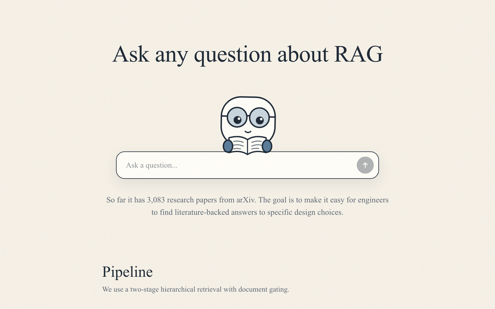
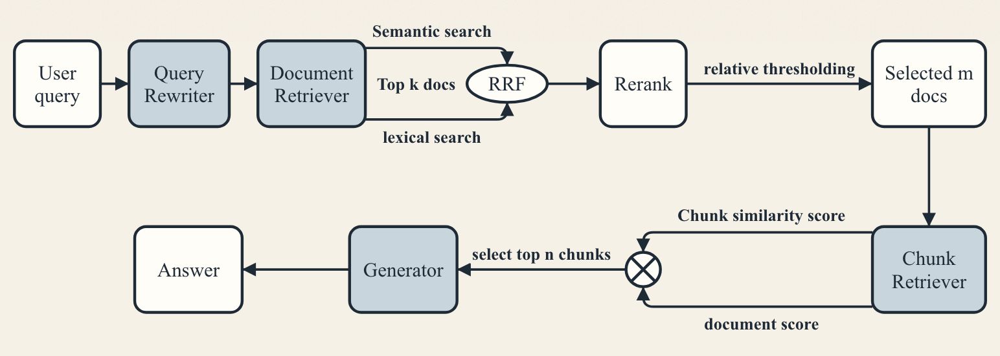

# RAG Q&A

An AI agent that answers questions about research papers from arXiv on a specific research topic.

**NB:** So far it has 3,083 research papers on RAG (105,276 chunks).

The goal is to make it easy for engineers and scientists to find quick, literature-backed answers to specific design choices.

## 1. Pipeline

We use a two-stage hierarchical retrieval with document gating.

The front-end calls four Supabase Edge Functions in order: `Query_rewriter`, `Document_retriever`, `Chunk_retriever` and `Generator`. Each message is logged in Supabase for 30 days against a scrambled visitor ID, and if OpenAI or Cohere hits a limit, visitors see a friendly message and I get an email.

For the front-end we use Next.js (Typescript, React & Tailwind).

## 2. Stages

### Preprocessing

I iterated on this stage so documents are processed and stored for effective downstream retrieval.

##### 1. Data modeling & section processing
- **Pydantic** data structures for documents and chunks, with rich metadata per chunk for retrieval  
- Extracted sections and used **GPT** for section-level summaries (key concepts + domain terms)  
- **GPT** document-level summary from section summaries, with the title and abstract added, used for document-level filtering before chunk retrieval  

##### 2. Chunking & embedding
- Sentence-level chunking per section (papers already structure ideas by section)  
- Embedded chunks (512 dimensions, stored at half precision so they fit on the free Supabase plan) and document summaries (1536 dimensions) with **OpenAI’s small embedding model**

### Query Rewriting

Raw user queries should not go directly to the retriever. **GPT** rewrites each query into a retrieval-optimized query, which is used for retrieval. The answer is still generated for the original question. Messages that are not about RAG, such as greetings, are filtered out at this stage, without searching the papers.

### Document Retrieval

This is the most important stage, mistakes here can lead to selecting irrelevant chunks later. I use hybrid retrieval (semantic + keyword search), keyword matching captures domain terms, semantic search handles synonyms and paraphrases. Because BM25 was difficult to integrate on Supabase, Lexical retrieval is implemented using PostgreSQL full-text search with a GIN index over a tsvector representation, which provides token-based matching over document summaries.

To make semantic search fast, I use an IVFFLAT ANN index with 5 inverted lists. This only performs distance computations with the most relevant cluster at query time. At 3,083 papers, it still returns 95% of the same top 25 documents as exact search (measured using the stored summaries as queries).

The semantic and lexical scores are computed per document, then fused with Reciprocal Rank Fusion (RRF). For each document $d$:

$$\text{RRF}(d) = \sum_{r \in \{\text{semantic}, \text{lexical}\}} \frac{1}{k + \text{rank}_{r}(d)}$$

where $k$ is a constant (60) and $\text{rank}_{r}(d)$ is $d$'s 1-based rank in ranking $r$. Documents ranking well in both lists get a higher score. The reason for using fused score is to make this scalable with a larger corpus where we want to filter out docs with low RRF; for now I still pass the top 25 from each search to the next stage, so RRF only merges the two lists.

After RRF, the documents are reranked with Cohere's rerank-english-v3.0, then selected using a relative threshold so the number of documents returned adapts to the query. A document $d$ is kept if:

$$d.\text{rerank\\_score} \geq \max_{\text{docs}} \text{rerank\\_score} - \Delta \quad \text{and} \quad d.\text{rerank\\_score} \geq \text{MIN\\_SCORE}$$

We apply a relative threshold ($\Delta = 0.3$) with a minimum score (0.01) to adapt document selection to each query and filter low-quality matches. The goal is to return as many papers as actually contain the answer (e.g., 10, 2, or 0). In practice, queries with low reranker scores are filtered by the absolute minimum score, but the threshold filters less when the top score is close to 1.0.

### Chunk Retrieval

The selected documents and their rerank scores are passed from the previous stage. Each chunk is scored as:

$$\text{chunk\\_score} = \text{rerank\\_score}_{d} \times \text{sim}(c, q)$$

where $d$ is the parent document, $c$ is the chunk, and $\text{sim}(c,q)$ is the chunk–query semantic similarity. Chunk relevance is modulated by document relevance. The top 10 chunks are selected for answer generation.

### Answer Generation

The top 10 chunks' content is passed as context to the language model (gpt-4o-mini). The model answers only from the retrieved papers. If they have related findings but no definitive answer, it says so and reports what they found. If they contain nothing related, it says so instead of using its own parametric knowledge. The model is good at concept explanation, comparison between methods, and also evidence providing. It is instructed to name the paper behind each finding, not to present one paper's result as a general rule, and to say when papers disagree.

## 3. Improvements

#### Automated document ingestion

Extend the corpus by adding a robust web-scraping and ingestion pipeline (e.g. arXiv API). This would allow continuous expansion of the knowledge base while preserving metadata such as authorship, publication date, and venue.

#### Cache and monitor results

Cache intermediate retrieval results (document rankings, reranker outputs, selected chunks) to reduce latency and cost. Add lightweight monitoring to track retrieval hit rates, reranker confidence distributions, and answer quality over time to enable iterative improvements.

#### Learned retriever for domain adaptation

Retrieval quality could be further improved by training or fine-tuning a domain-specific retriever.

#### Systematic evaluation of answer quality
Evaluate generated answers against reference answers using token-level F1 to capture partial correctness and Exact Match (EM) for strict accuracy. This provides a clearer signal of both factual correctness and coverage, especially for technical questions.

#### Memory of previous questions
Enable the agent to retain the context of the conversation by storing previous questions and answers, using short-term session memory or long-term persistent memory, so it can handle follow-ups.
